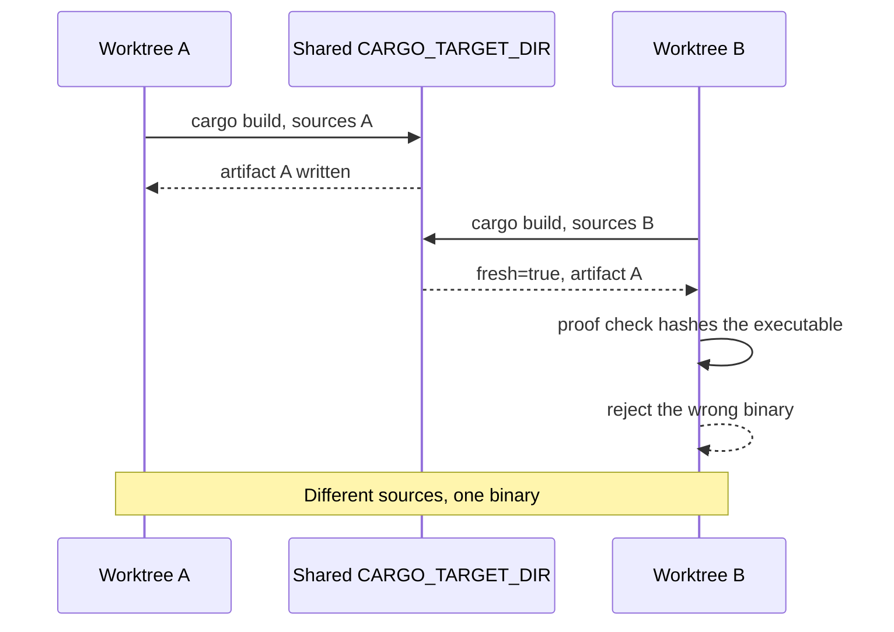

While verifying a small fix in [OpenYR](https://github.com/johnnyhuy/openyr), my
native Rust rewrite of Command & Conquer: Red Alert 2: Yuri's Revenge for macOS,
the proof step that runs the app and compares what it draws rejected the executable
that `cargo build` had just reported building. The build had succeeded. The binary
on disk was the one from before the fix.

The fix itself was narrow. Pressing F5 to quicksave opens a save success or error
message, and that message skipped the input cleanup that ordinary menu entry runs,
so a placement, repair or attack-move mode survived the dialog and an old key
release could turn into an order after returning to the match
([#237](https://github.com/johnnyhuy/openyr/issues/237),
[the fix](https://github.com/johnnyhuy/openyr/pull/239)). My proof harness runs
the app before and after a change and compares the pixels, and it checks the
executable before it trusts that comparison. That check rejected the binary.

`cargo build --workspace --release --locked` had returned exit code 0 and reported
the package fresh. A rebuild after `cargo clean -p yr-app --release` produced a
different SHA256, which is the only reason the staleness was visible at all.

The follow-up work traced the shape of the trap. With an inherited
`CARGO_TARGET_DIR` shared across worktrees, one tree's build artifact can be
served to another while Cargo still reports the build fresh:

A bounded probe produced exactly that: one worktree's artifact appearing in the
other's output while Cargo reported `fresh=true`, and isolated builds in the two
trees producing the correct outputs despite the inherited target variable.

So the rule I took from this: a green build proves the compiler ran, or that the
cache believes it did. It does not prove the artifact in front of you is the one
you just built. Anything that builds and then runs a binary, especially across
worktrees or against a shared CI cache, should verify the artifact's identity
rather than the build's exit code.

What I changed in [#240](https://github.com/johnnyhuy/openyr/pull/240), tracked as
[#238](https://github.com/johnnyhuy/openyr/issues/238):

- Build the proof in a fresh isolated Cargo target that no other tree inherits,
  and remove that target after copying the output.
- Take the requested executable from Cargo's own `--message-format=json` artifact
  events instead of assuming a fixed path.
- Copy it beside a receipt recording the source tree state, byte size and SHA256.
- Make `verify` and `run` reject dirty source, a different source tree or a
  replaced executable. `run` launches the verified copy and nothing else.

Negative tests cover the refusals the guard should produce: a stale source, a
changed executable with `run` declining to execute, dirty source, malformed and
oversized receipts, a failed Rust compilation, and identical source appearing in
a new commit. The probe reports actual behaviour and accepts toolchains that have
already fixed the reuse. The build and validation logs sit beside the
[receipt record](https://github.com/johnnyhuy/openyr/tree/460620c9d96274b2045dfde89c83d42f8b3a2061/proof/build-provenance).

The receipt is deliberately narrow. It catches accidental artifact and source
mismatch. It does not fingerprint retail game data, ignored inputs, compiler
wrappers or environment settings, and it is not a signed attestation. No physical
Mac, Retina, audio-device or original-game runtime checks were part of this slice.
