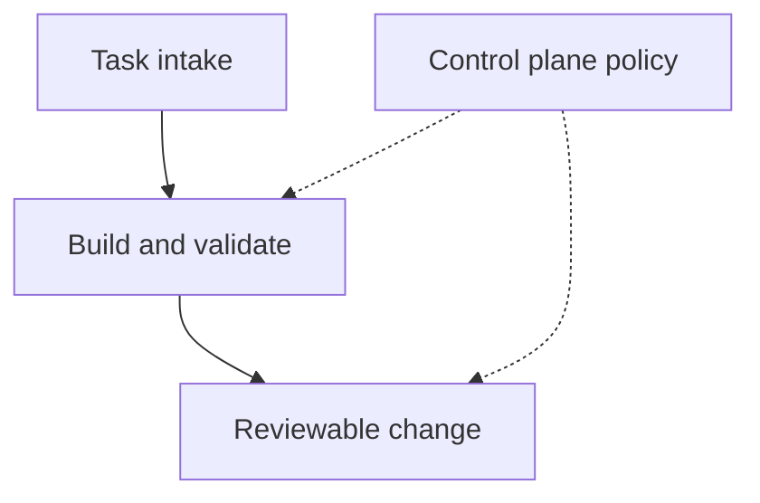

I compared AI software factories with agent control planes while researching how
coding agents can work through a GitHub issue backlog. I wanted to understand
what changes when that work is split across worktrees and remote machines.

[Encore's architecture write-up](https://encore.dev/articles/ai-software-factory-architecture)
helped separate the delivery loop from the rules governing it. The loop takes a
task into an isolated environment, builds and validates a change, then moves it
towards deployment. The control plane holds configuration, permissions and
deployment policy. The worker operates within those rules.

This is a conceptual sketch of the separation: solid arrows show the work moving
forward; dotted arrows show the policy constraining it.

[Detent](https://github.com/michaelhvisser/detent) makes the state transitions
concrete. Its documented workflow uses a GitHub Projects board to move an issue
through a worktree, validation and human review, with a serialised merge lane.
[Sandcastle's workflow](https://github.com/copperbox/sandcastle-workflow) keeps its
durable state in git and GitHub and reconstructs it on the next run. It leaves
the target-branch merge to a person. Those are useful design choices to compare,
not guarantees I've tested.

My takeaway is to ask where task ownership and the next allowed transition live
before adding workers. A worktree gives a worker somewhere to edit; it doesn't
by itself decide who owns an issue. Where that shared ownership should live
across machines remains open for me. This was research, with no installation or
recovery test.
