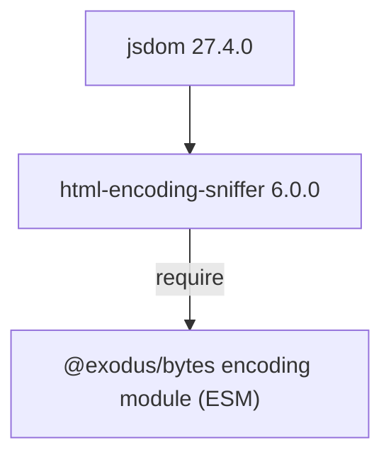

I started moving my [Backstage checkout](https://github.com/echohello-dev/backstage)
from 1.55.3 to 1.56.0. Reconciling the app template brought in Jest 30.5.2 and
jsdom 27.4.0. Install completed with warnings and lint passed. Then
`mise run test` finished with two suites failing to load and one passing.

Both failures were `ERR_REQUIRE_ESM`: `html-encoding-sniffer` tried to
`require()` the ESM package `@exodus/bytes/encoding-lite.js`. They stopped before
assertions ran in those suites. The installed dependency chain was:

_The failing load was inside the test environment's dependencies._

[Backstage's Jest migration guide](https://backstage.io/docs/tutorials/jest30-migration/)
puts Jest and its environment dependencies in the root manifest. That makes
template reconciliation part of the test-runtime upgrade, even when application
code has barely changed.

My checkout still pins Node 22.11.0. The installed
[`html-encoding-sniffer` 6.0.0 manifest](https://github.com/jsdom/html-encoding-sniffer/blob/v6.0.0/package.json)
requires `^20.19.0 || ^22.12.0 || >=24.0.0`. On the Node 22 line, that pin is too
old. [Node 22.12 enabled `require(esm)` by default](https://nodejs.org/en/blog/release/v22.12.0),
which makes the runtime mismatch a concrete next check.

I haven't rerun the suite on a supported Node version or verified a repair.
The upgrade remains local and uncommitted, with no upgrade PR opened. Before
changing test assertions, I need to align the runtime with the installed
packages and rerun the same test command.
