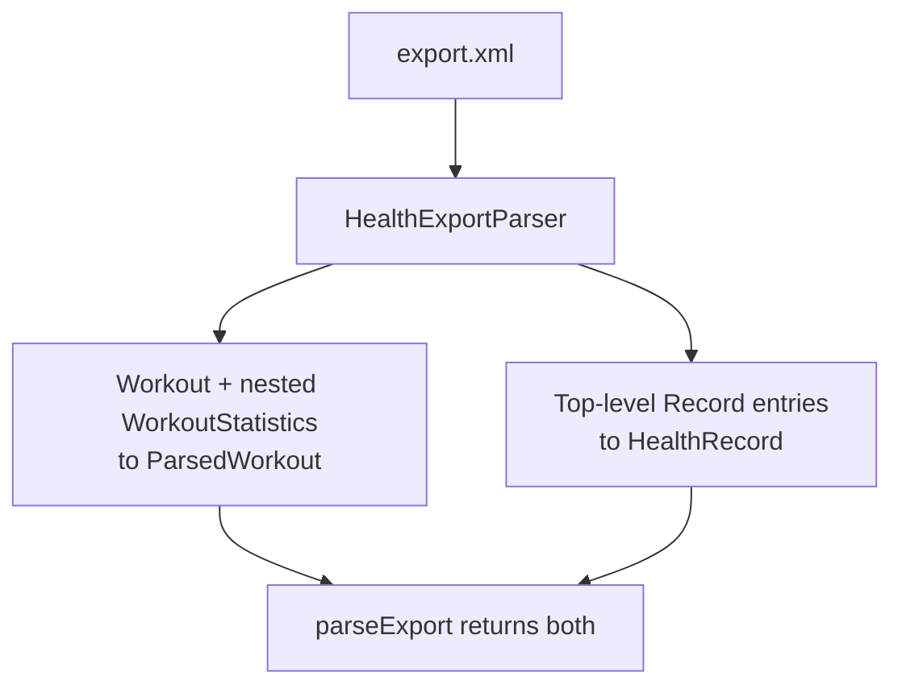

[BetterFit](https://github.com/echohello-dev/betterfit), my workout tracker
with auto-tracking capability, now reads the export Apple Health produces. The
useful lesson was that an export is not one dataset. It carries two data
layers that need separate models.

Workouts come first. A Workout element carries its own nested
WorkoutStatistics children, and ParsedWorkout exposes per-workout active and
basal energy, distance, step count, and heart-rate summaries of average,
minimum and maximum, with unit normalisation to kilocalories and metres
([PR #29](https://github.com/echohello-dev/betterfit/pull/29),
[closing #28](https://github.com/echohello-dev/betterfit/issues/28)).

Everyday metrics arrive differently. Step count, heart rate, resting heart
rate, active and basal energy, distance, body mass and sleep analysis records
are top-level Record entries, not part of any workout. The new HealthRecord
model captures them, and HealthExportParser returns them through
`parseRecords` or alongside the workouts through a combined `parseExport`
([PR #31](https://github.com/echohello-dev/betterfit/pull/31),
[closing #30](https://github.com/echohello-dev/betterfit/issues/30)).

_Keeping the layers separate mirrors the export instead of flattening it._

The parser is Foundation-only, so the import adds no third-party dependency.
Verification was the repository's lint gate with no new violations in the
added files, keeping the repository total at its pre-existing baseline.
Parsing structure is not the same as summarising it: daily health summaries
aggregated from the records are the next slice and remain an open pull
request ([PR #33](https://github.com/echohello-dev/betterfit/pull/33)).
