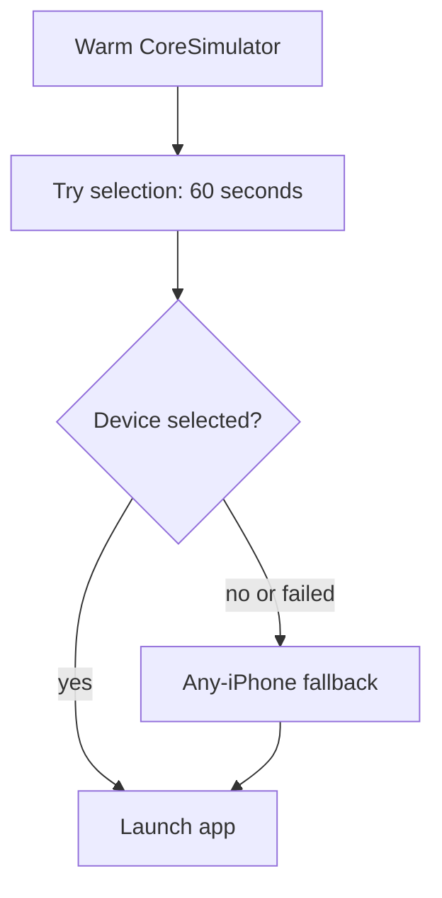

The new BetterFit iOS CI jobs exposed a difference between my warm local setup
and a fresh GitHub runner. The first `simctl` query could spend long enough
starting CoreSimulatorService to exceed the selection script's fifteen-second
timeout.[^fix]

The fallback was there, but the failed pick exited before it could run.

I changed the task to warm the daemon before querying, gave the pick sixty
seconds and let an empty or failed selection reach the any-iPhone fallback.
That addressed the setup path rather than just increasing the timeout around
the whole CI job.

_The revised setup lets a failed selection reach the fallback before app launch._

## First launch has its own cost

There was a second budget problem after selection. The app-launch poll allowed
twenty seconds, and each test had a sixty-second wall that also included
`resetAndLaunch`. A fresh install on a loaded runner could consume most of that
before the assertions got going.

The launch poll moved to sixty seconds and the per-test budget to 120. The local
e2e run passed four tests in 58 seconds after the fixes. The PR records the
cold-start and forced-empty-selection checks separately from the earlier CI run,
which had passed UI tests and coverage but hit the e2e time limit.

The fix merged with the warm-machine path unchanged. It was a useful reminder
that a fallback is only real if the error path can actually reach it.

[^fix]: [BetterFit's cold-runner and e2e timing fix](https://github.com/echohello-dev/betterfit/pull/26).
