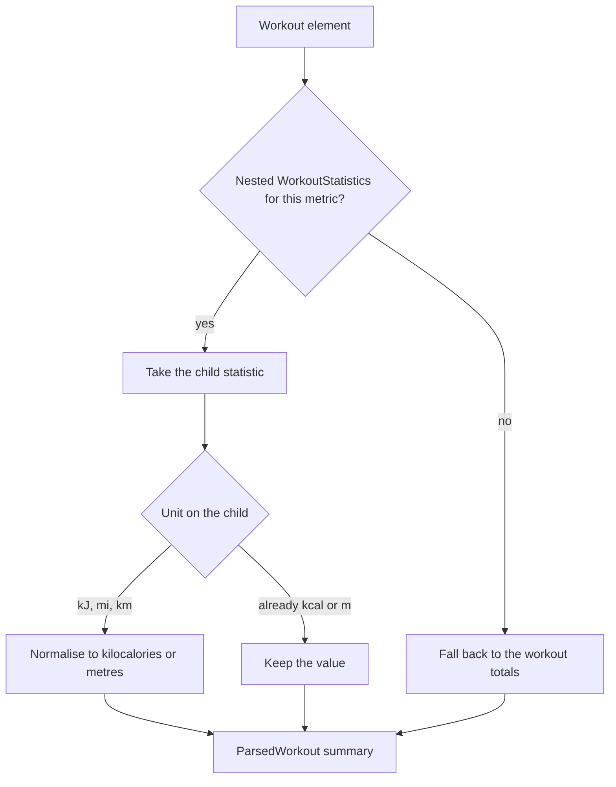

I am building [BetterFit](https://github.com/echohello-dev/betterfit), a Swift
Package training companion, and one slice of its Apple Health work is a parser
for `export.xml` that runs off device and inside the test suite. The part that
looked simple, taking the numbers off each workout, is where the export keeps its
detail one level below the element I first read.

A `Workout` element carries coarse totals: duration, `totalDistance`,
`totalEnergyBurned`. The per-metric detail nests inside it, in `WorkoutStatistics`
children written per HealthKit quantity type for the workout window:

```xml
<Workout workoutActivityType="HKWorkoutActivityTypeRunning"
         duration="30" durationUnit="min"
         totalDistance="5" totalDistanceUnit="km"
         totalEnergyBurned="300" totalEnergyBurnedUnit="kcal"
         startDate="2026-04-19 07:00:00 +1000"
         endDate="2026-04-19 07:30:00 +1000">
  <WorkoutStatistics type="HKQuantityTypeIdentifierHeartRate"
                     average="150" minimum="110" maximum="175"
                     unit="count/min" />
</Workout>
```

A heart-rate statistic carries average, minimum and maximum. A distance or
energy statistic carries a sum. Each child also carries its own unit string, and
the units are not consistent: the parser has to cope with energy in kilocalories
or kilojoules and distance in kilometres or miles. So each metric is resolved
from the inside out, and the units are converted once at the boundary.



So the parser prefers the child statistic and falls back to the total written on
the workout only when that statistic is absent, and it normalises every unit at
the boundary, kilojoules to kilocalories and miles to metres, so the model stores
one unit per metric. Active energy and distance resolve that way. Basal energy,
heart-rate summaries and step count come from statistics only and stay nil when
no child carries them.

The third rule was to never drop what the parser does not recognise. HealthKit
grows new quantity types, and a statistic type outside the known list is kept as
`.other(type)` with its raw value, so an unfamiliar metric cannot silently remove
a workout from the summary.

The parser is Foundation only, which is what keeps it running off device and in
unit tests. On Linux that needs a conditional `import FoundationXML` alongside
`Foundation`, because `XMLParser` lives outside Foundation there, and without the
guard the same source does not compile on both platforms.

The slice merged as [#29](https://github.com/echohello-dev/betterfit/pull/29),
closing [#28](https://github.com/echohello-dev/betterfit/issues/28). The 15 new
tests pin the rules down: preferring a statistic over the workout total, falling
back when statistics are absent, normalising miles and kilojoules, keeping
unknown statistic types, and throwing on malformed XML. Aggregation, file output
and feeding these numbers into recommendations deliberately stayed out of this
slice and remain on the [ingestion](https://github.com/echohello-dev/betterfit/issues/6)
and [statistics](https://github.com/echohello-dev/betterfit/issues/7) epics. The
[next slice](https://github.com/echohello-dev/betterfit/pull/31) taught the same
parser to read top-level `Record` elements.

What I took from it: when a format nests the real data below the obvious element
and lets each child pick its own unit, resolve each metric from the inside out
and convert once at the boundary. Keeping unknown values beats dropping rows the
code does not understand yet.
