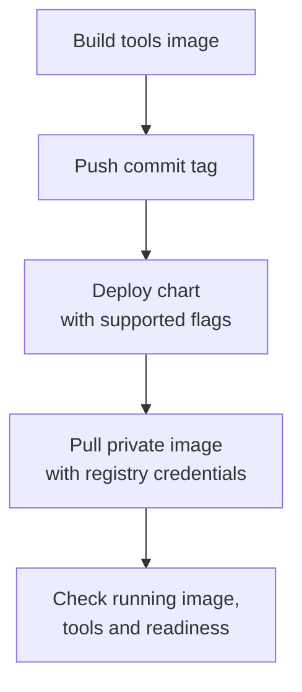

I gave my [OpenClaw](https://github.com/openclaw/openclaw) deployment a tools image so it could have Chromium, Python image/chart libraries and local Mermaid rendering available inside the container. I also made its temporary directories and npm install location writable.

The image built and pushed successfully. Deployment then stopped at `unknown flag: --digest-source`: the Skaffold on the runner did not accept the flag used in the deploy command. Removing it got the chart applied, which exposed the next failure. The cluster could not pull the private image and received a 401.

I attached registry pull credentials through the service account. Kubernetes documents this separately from the credentials used to push an image.[^1] A successful push had only checked one side of the path.

The final path builds the image before deploying its commit tag. I removed OpenClaw from the general chart deployment path so it cannot get ahead of that build.

The rollout completed, the pod was Ready, and `/readyz` returned 200. Inside the running container, the expected tool paths were present, Python imported Pillow and matplotlib, and the temporary/cache directory permissions matched the change. Those are the checks I have so far. They establish the runtime prerequisites; a browser rendering task and an actual skill install need their own checks.

[^1]: [Kubernetes private-registry image pulls](https://kubernetes.io/docs/tasks/configure-pod-container/pull-image-private-registry/) explains `imagePullSecrets` and links to configuring them on a service account.
