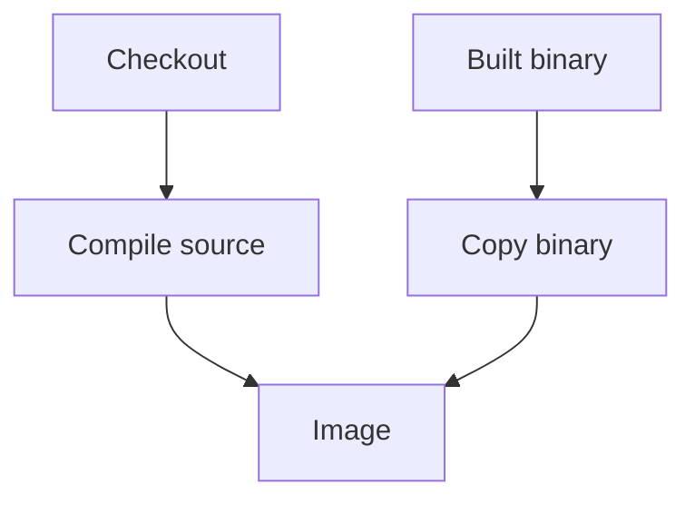

The Karpenter Hetzner provider release finally got past signing, then stopped at
the first Docker `COPY` with `"/go.sum": not found`.[^fix]

The file was not missing from the repository. I had two different build paths
colliding. The normal Dockerfile builds from source and expects `go.mod`,
`go.sum` and the code. GoReleaser was handing Docker a temporary context containing
the binary it had already built.

I added a separate `Dockerfile.goreleaser` for that packaging step:

```dockerfile
FROM gcr.io/distroless/static-debian12:nonroot
COPY karpenter-provider-hetzner /bin/karpenter-provider-hetzner
USER 65532:65532
ENTRYPOINT ["/bin/karpenter-provider-hetzner"]
EXPOSE 8080 8081 9443
```

Both GoReleaser Docker entries now use it. The source-building Dockerfile stayed
in place for the local `docker-build` task.



_Two build contexts, with a Dockerfile that matches each input._

## Package the thing already built

The final image kept its distroless base, non-root user, entrypoint and ports.
What changed was the input contract: this path packages a staged executable,
not a checkout.

That also removed a duplicate Go build inside the image, including the emulated
arm64 compile under QEMU. The PR records a configuration check and a real local
packaging build. I am keeping that separate from claiming every later release
stage was solved by this one change.

[^fix]: [The provider's separate GoReleaser packaging Dockerfile](https://github.com/echohello-dev/karpenter-provider-hetzner/pull/66).
