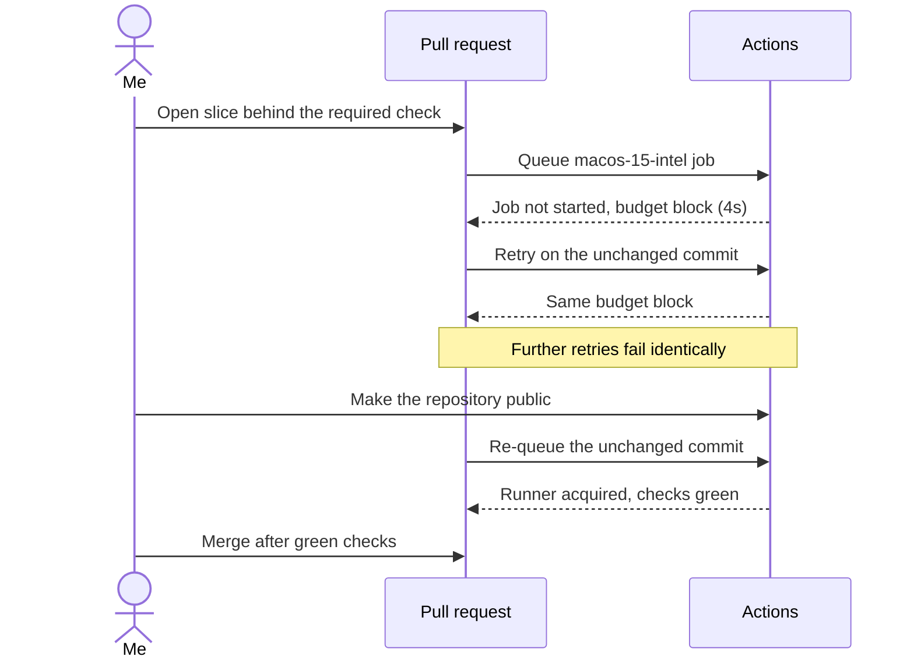

[OpenYR](https://github.com/johnnyhuy/openyr) is my native Rust rewrite of
Command & Conquer: Red Alert 2: Yuri's Revenge for macOS. It targets Apple
hardware, so its required `test` check runs on a `macos-15-intel` GitHub-hosted
runner. By the afternoon of 7 November two locally verified slices were
stacked up behind that check: [showing current attack targets for selected
units](https://github.com/johnnyhuy/openyr/pull/231) and [typing the retail
superweapon and sound data](https://github.com/johnnyhuy/openyr/pull/233).
Neither check had failed on the code. They had never run on it.

The job fails in about four seconds. Not a step in the job. The whole job. The
annotation on the check reads "The job was not started because an Actions
budget is preventing further use", and the job's step list is empty: not one
step executed.[^run] That shape is easy to file as flaky CI and retry. I
requeued the same commits and got the same seconds-long failure; one pull
request reached a third blocked attempt before anything changed. The block
and its clearing are recorded on
[#232](https://github.com/johnnyhuy/openyr/issues/232).

The annotation is a billing state, not a test result. Standard GitHub-hosted
runner time on private repositories draws from the account's Actions budget,
and once that budget is exhausted GitHub refuses to start further jobs
outright.[^billing] macOS runners are the expensive end at $0.062 per minute,
so a Rust test suite on `macos-15-intel` drains the pool quickly. Nothing in
the repository can fix that. Both slices were green locally before any of
this: the workspace test suite, Clippy with warnings denied and formatting
all passed.

The fix was not a code fix. It did not touch the workflow or the billing
settings either. I made the repository public on 7 November; it carries a
GPL-3.0 license. Standard GitHub-hosted runners in public repositories are
free and sit outside the private-repository budget,[^billing] so the next
queued attempts on the unchanged commits (`0dfeb003` and `3e20733d`) acquired
macOS runners and passed formatting, denied-warning Clippy and the test
suite. [#231](https://github.com/johnnyhuy/openyr/pull/231) and
[#233](https://github.com/johnnyhuy/openyr/pull/233) merged minutes later,
after those green checks. A third slice that evening, [readable pause-recovery
diagnostics](https://github.com/johnnyhuy/openyr/pull/235), ran its check
straight through and merged the same way.

What I take from it: a required check that "fails" in seconds with a budget
annotation is not evidence about the code, and rebasing or re-running does not
move it. The levers are the budget, self-hosted runners or repository
visibility. The tell is the empty step list, because the job never started.

The project is out in the open now, and the merged slices are data typing and
diagnostics presentation. Charging, firing, effects and sound playback wiring
for the new superweapon registry remain open, as does original-game
calibration for the native layouts behind the fixes.

[^run]: The first [blocked run for PR #233](https://github.com/johnnyhuy/openyr/actions/runs/42340674065) carries the annotation on its first attempt, and its third attempt is the green run on the unchanged head. PR #231's [equivalent run](https://github.com/johnnyhuy/openyr/actions/runs/42313479364) blocked on its first three attempts and went green on its fourth.
[^billing]: GitHub's [billing documentation for GitHub Actions](https://docs.github.com/en/billing/managing-billing-for-your-products/managing-billing-for-github-actions/about-billing-for-github-actions) covers both the free standard runners in public repositories and the block on accounts that exhaust their budget.
