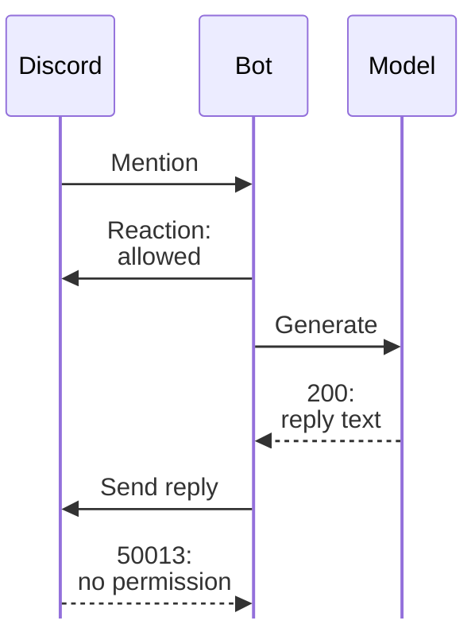

I deployed OpenClaw to my home cluster this afternoon and pointed it at a
Discord server I run. I kept it on the private network only, so it is reachable
over the tailnet and not from the public internet, and I gave it broad read
access to the cluster's deploys and logs on purpose, since half the point is
asking it why something did or did not roll out.

Two config bugs on the way in. The model provider's API key setting held the
name of the environment variable rather than a reference to it, so the literal
variable name went out as the key and every call came back 401. Once the chart
referred to the variable itself, a one-token call from inside the pod returned 200. I also put MiMo 2.6 Flash first with OpenRouter's free models as the
fallback, which is the order I wanted anyway.

Then came the actual problem: I mentioned the bot and nothing happened. No
reply, no error in the channel, just silence. The one thing the bot did do was
add a reaction to each mention, so it looked alive. My first question to myself
was the obvious one: why is it not responding?

The logs settled it. The model was answering; those calls returned 200 and
produced text. The send was what failed. Discord's permission model treats
adding a reaction and sending a message as two separate permissions, and a
channel's permission overwrites can grant one while denying the
other.[^perms] My overwrites allowed Send Messages for a role the bot does not
have, so every reply came back 50013, missing permissions, while the reaction
kept working because it needs a permission the bot does have.

_The reaction showed activity, while the send response identified the delivery failure._

That mismatch is the part worth remembering. An ack reaction proved the
gateway received the mention and a reply was generated. It proved nothing about
whether the bot could post. I spent the first stretch of debugging assuming
delivery was fine because the reactions kept arriving.

The fix is a channel permission change rather than anything in the bot, either
granting Send Messages to the bot's role or giving it the role the channel
already trusts. Until that happens the bot stays silent in that channel. Also
still open on my side: the GitHub App wiring so it can act on repositories, which
needs the app installed before the in-pod token helper does anything useful.

[^perms]: https://discord.com/developers/docs/topics/permissions
