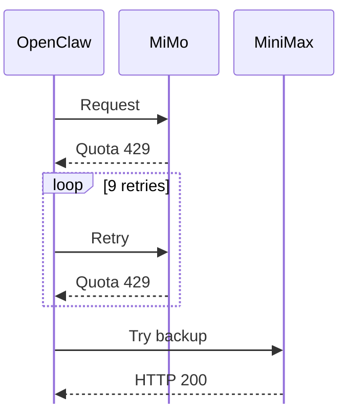

I had MiniMax configured as a backup in [OpenClaw](https://github.com/openclaw/openclaw),
but Discord turns were still waiting on MiMo's `429 quota exhausted` responses.
The logs showed why: the gateway made nine same-model retries before trying
MiniMax. That next provider returned HTTP 200. A later log recorded the fallback
candidate succeeding, although its first stream had also hit `ECONNRESET` and
needed recovery.

_The backup was reachable after the primary's retry budget. HTTP 200 marks the stream opening, not message delivery._

[OpenClaw's failover documentation](https://docs.openclaw.ai/concepts/model-failover)
describes recovery on the same model before rotating profiles or changing
models. The next Discord turn started with MiMo again and repeated the quota
errors, despite the earlier fallback succeeding.

I changed the primary to MiniMax M3.1 Flash Preview and kept OpenRouter free as
the fallback. MiMo stays in the model catalogue, outside that chain. The change
was merged and deployed, and I checked that the running gateway had the new
primary and passed its readiness check.

A fresh Discord turn is still needed to measure the reply latency after that
change. The useful check here is to follow the actual retry and provider order
in the logs, then inspect the running configuration. A backup in the config
doesn't tell you how long the first provider will be retried.
