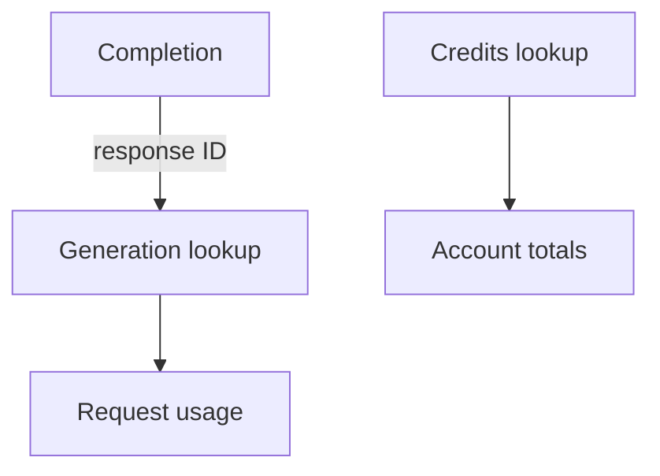

The OpenRouter provider already had a chat-completion resource. I extended it so
the resulting generation could be inspected too: cost, latency, token counts
and provider details through `openrouter_generation`.[^change]

The completion's response ID gives that lookup something concrete to follow.
I also added `openrouter_credits` for account-level purchased and used credits,
without mixing those totals up with one generation's usage.

_A request audit follows its generation ID; account totals answer a different question._

## Zero still means something

The same pass exposed more request parameters. That brought a subtle configuration
boundary into view: a caller setting a numeric option to zero is not necessarily
the same as leaving it unset.

The implementation used the raw Terraform configuration for the affected numeric
fields so explicit zero values were sent instead of disappearing during the
ordinary value lookup. Frequency and presence penalties were among those fields.

The change included provider documentation and examples with the new data
sources. It moved the provider beyond creating a completion into being able to
follow what that request produced, while keeping request configuration distinct
from the usage information returned afterwards.

[^change]: [Generation, credits and request-parameter support](https://github.com/echohello-dev/terraform-provider-openrouter/pull/6).
