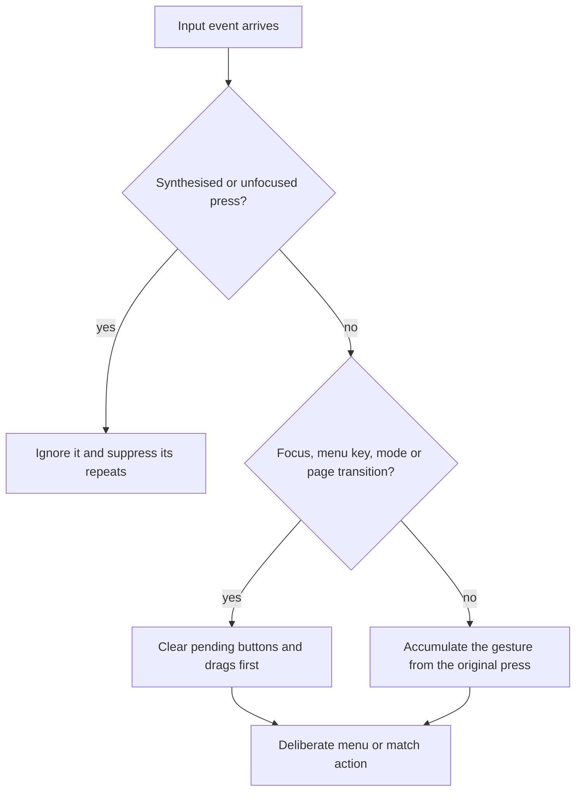

[OpenYR](https://github.com/johnnyhuy/openyr) is my native Rust rewrite of
Command & Conquer: Red Alert 2: Yuri's Revenge for macOS. The input pass across
8 November looked like seven unrelated fixes. Read together they are one bug
class: state outliving the transition that made it irrelevant.

The sharpest symptom deleted a file. When a window regains focus, macOS
synthesises key presses for whatever the user is still physically holding, and
those synthesised presses were routed as deliberate menu and game actions. A
synthetic Enter deleted a listed temporary save
([#255](https://github.com/johnnyhuy/openyr/issues/255),
[the fix](https://github.com/johnnyhuy/openyr/pull/256)). Synthesised and
unfocused presses are now ignored before either handler runs, their follow-on
repeats are suppressed, and release cleanup stays active across modal and
focus changes.

The menu repeated the shape twice. Keyboard navigation left held mouse buttons
and slider drags armed, so in a Delete confirmation Tab could move focus to
"Keep current" while releasing the old mouse press still deleted the selected
file ([#274](https://github.com/johnnyhuy/openyr/issues/274),
[the fix](https://github.com/johnnyhuy/openyr/pull/275)). A held attack-move
key re-armed the mode through OS key repeats, converting a later ordinary
order into another attack-move
([#276](https://github.com/johnnyhuy/openyr/issues/276),
[the fix](https://github.com/johnnyhuy/openyr/pull/277)). And a right-click
during a held left-button gesture left the unfinished selection drag active,
where a later left release could commit stale input
([#263](https://github.com/johnnyhuy/openyr/issues/263),
[the fix](https://github.com/johnnyhuy/openyr/pull/264)).

Two bugs were the opposite failure: continuous gestures measured one event at
a time. Repeated one-pixel mouse motions never accumulated past the drag
threshold, so a real camera drag stayed still
([#259](https://github.com/johnnyhuy/openyr/issues/259),
[the fix](https://github.com/johnnyhuy/openyr/pull/260)). High-resolution
menu wheel events each scrolled one row, so five minus-ten-pixel events jumped
five rows while a three-line event moved one
([#268](https://github.com/johnnyhuy/openyr/issues/268),
[the fix](https://github.com/johnnyhuy/openyr/pull/269)). Both fixes
accumulate displacement from the original press, or fractional rows on the
existing native fifty-pixel-per-row conversion, instead of trusting each
event's size.

_The guards run before any handler, so a stale press can no longer reach one._

One leak was spatial rather than temporal. Dragging a world selection box over
the sidebar painted the rubber band across the UI and let the picker include
anchors hidden behind it, because painting and picking computed different
bounds. They now share clipped world-viewport bounds
([#278](https://github.com/johnnyhuy/openyr/issues/278),
[the fix](https://github.com/johnnyhuy/openyr/pull/279)).

The rule I am carrying into the rest of the game: anything that can outlive a
transition gets cleared or keyed by that transition first, synthesised input
is never deliberate, and a continuous gesture is measured from where it began.
Every slice ran the workspace test suite, Clippy with warnings denied and
formatting. The harvest cursor that landed in the same pass ships a retail
cursor test that compares every phase of the new harvest state against
independent SHP and palette decoding
([#267](https://github.com/johnnyhuy/openyr/pull/267)).

What stays open is exactly what cannot be proven locally: the original-game
pointer thresholds and the behaviour of these paths under physical input
delivery are still unverified.
