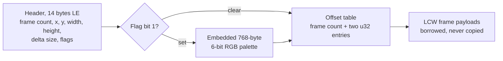

The last open formats milestone in
[OpenYR](https://github.com/johnnyhuy/openyr), my native Rust rewrite of
Command & Conquer: Red Alert 2: Yuri's Revenge for macOS, is done:
`yr-formats::WsaFile` parses Westwood WSA container metadata and frame
ranges, `mix-dump scan` routes recovered names to it, and the format record
lands in
[docs/formats/wsa.md](https://github.com/johnnyhuy/openyr/blob/main/docs/formats/wsa.md)
([PR #273](https://github.com/johnnyhuy/openyr/pull/273),
[closing #272](https://github.com/johnnyhuy/openyr/issues/272)).

WSA is the XOR-delta animation format from the Dune II and Command and Conquer
era. Each stored frame is LCW data that expands to XOR-delta commands against
the previous image. The parser reads metadata and frame ranges only; decoding
either layer is deliberately out of scope.[^wiki]

The container layout:

_The delta field is the unpack size the encoder recorded, and published notes
put it 37 bytes below the actual requirement, so the parser reports it without
enforcing it.[^dune]_

The offset entries are relative to the file start with palette bytes ignored.
A zero first entry marks a chained clip that builds on a previous file's final
frame. The final entry is either zero, leaving the previous entry as the data
end, or the data end itself, in which case the previous entry starts an extra
loop frame that maps the final image back to the first.

Validation policy is where the parser earns its keep. Counts and sizes use
checked arithmetic against the input length before either table is allocated.
Dimensions must be nonzero and at most 8192 per axis. Offsets must start at
the table end or the zero chain marker, strictly increase, and end exactly at
EOF after palette adjustment. Frame ranges borrow the input; no payload is
copied.

The retail evidence is a negative result. The local Yuri's Revenge install
ships no WSA assets: a `mix-dump scan` census on 8 November classified every
entry in the sixteen retail archives, 13,061 unique IDs across aud, binary,
bink, csf, fnt, hva, ini, mix, pal, pcx, shp, tmp, vxl and wav, with zero
errors and no WSA kind, and the install directory holds no loose .wsa files.
The parser therefore completes format coverage for the earlier games and
addon content with synthetic known-answer fixtures plus hostile-header cases,
not retail byte comparisons.

The format carries no magic bytes, so `mix-dump scan` routes entries to the
parser only through a recovered .WSA name, and a malformed named entry reports
a scan error like every other strict parser. The field layout follows the
public format description at ModdingWiki, cross-checked against the Dune II
notes at savoch.net. No original game code was consulted or copied.[^wiki][^dune]

Frame payload decoding stays out of scope, as do the Dune II header variant
without position and flag fields and the later variant with a u32 delta field.

[^wiki]: [ModdingWiki: Westwood WSA Format](https://moddingwiki.shikadi.net/wiki/Westwood_WSA_Format).
[^dune]: [Dune II file formats: WSA](https://www.savoch.net/ben/dune2/formats/wsa/).
