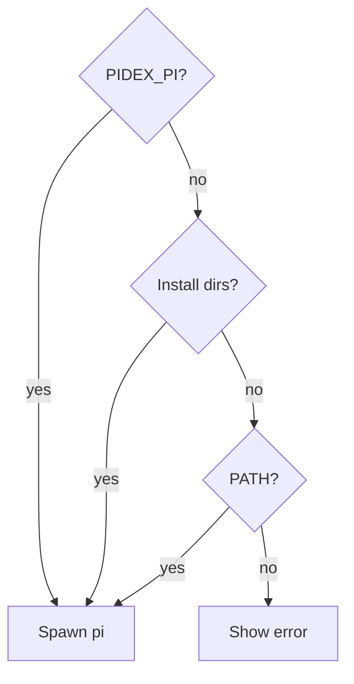

Pidex opens Pi sessions from an Electron shell, and launching the app from
Finder could not spawn the Pi CLI at all. A new session died with an uncaught
`spawn pi ENOENT` in the main process, so the failure never reached the window.
Launching the same build from a terminal worked, because the shell had already
put `pi` on PATH.

The cause is the standard macOS split. A GUI-launched app inherits a minimal
PATH, not the one a login shell builds, and `pi` lives somewhere like
`~/.bun/bin` or `~/.local/bin`. The old lookup in Pidex effectively trusted
PATH first, so it found the binary in a terminal and nowhere else.

## Resolving the binary instead of trusting PATH

I made the change with a coding agent in Cursor, then checked the resolver
behaviour against a stripped-down PATH on my machine.[^pr] The new resolution
order is a `PIDEX_PI` override when it points at a real absolute binary, then
the usual install directories (Bun, Homebrew, `~/.local/bin` and mise shims),
and only then a walk of PATH. The spawned session also gets those directories
added to its own PATH, and Windows builds look for `pi.cmd`, `pi.exe` and `pi`.

_The resolver no longer depends on Finder inheriting a login shell environment._

A missing binary now comes back to the window as an error the session creation
returns, rather than an uncaught exception in the main process. A failed launch
reads as a failed launch instead of a dead app, and the message says what to do:
install it, or set `PIDEX_PI`.

The resolver has a dedicated unit test file now. The PR records 40 unit and 8
integration tests passing, plus a check that resolution still finds the binary
with `PATH=/usr/bin:/bin` on my machine. What I have not done is open a session
from a Finder-launched packaged build: the fix is on main but not in the
installed 2026.10.14-2 disk image, so that final check waits for the next
release.

The general point is one Electron apps keep relearning. A bundled CLI's
environment assumptions are not limited to its arguments. Resolving an absolute
path up front is more honest than inheriting whatever PATH the launch method
happened to provide.

[^pr]: [The Pidex fix for Finder launches missing `pi`](https://github.com/echohello-dev/pidex/pull/26).
