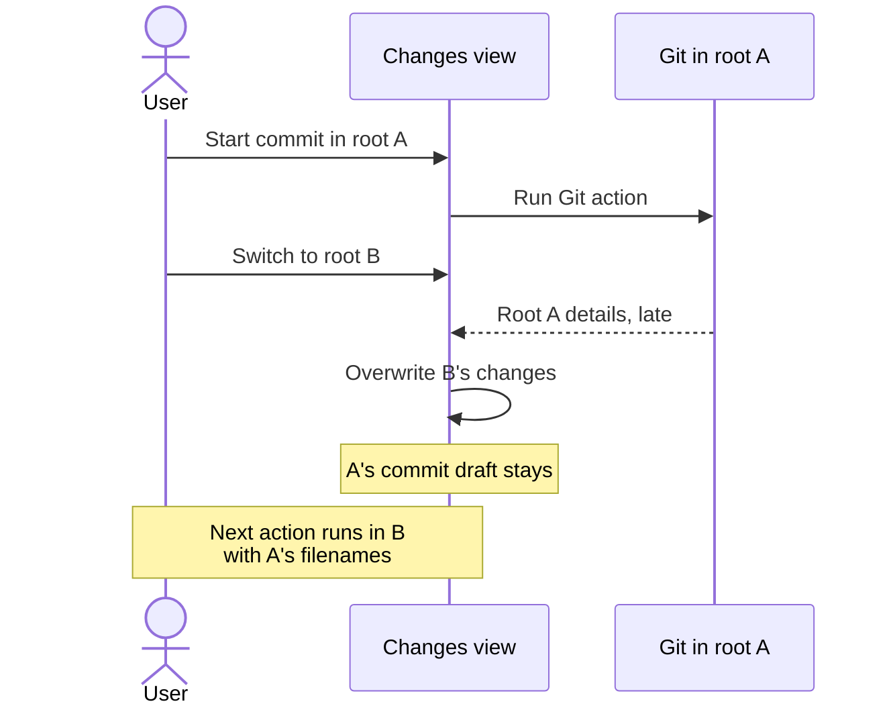

I took the first milestone of [Pidex](https://github.com/echohello-dev/pidex)'s
[multi-repo workspace plan](https://github.com/echohello-dev/pidex/issues/5)
from an approved design to a local implementation: group the repository roots I
already have and switch between them safely.

The constraint comes from Pi's session model, where a session runs in one
working directory.[^pi] So a workspace group is a set of independently
selectable roots, and switching roots preserves background sessions instead of
retargeting them. The slice migrates existing registry entries into groups,
scopes drafts and defaults per root, and passes the local suites: 66 unit, 32
component and 35 Electron tests. It stays uncommitted on top of the open
session-tree navigation work in
[PR #33](https://github.com/echohello-dev/pidex/pull/33), not on main.

## Reviewing the diff for switching races

Before the slice went near review, I asked for a read-only pass over the diff
against #33's head, checking correctness, migration safety and switching races.
It returned four findings, and they share one shape: state and identity owned by
one root survive into another.

The Changes view is the sharpest case. Start a commit in root A, switch to root
B with Changes restored, and the shared view keeps A's commit draft. A's late
details response then overwrites B's displayed changes, and the next action runs
with B's working directory and A's filenames.

Three more findings carry the same leak:

- A root that is missing at migration time and later resolves through a symlinked
  parent keeps its old noncanonical path, so the ownership check rejects resume
  and startup. Recovered paths need normalising while keeping root IDs and
  aliases.
- Switching away during a history preview load caches the incomplete result.
  Returning finds a non-null preview with loading cleared, so continuation stays
  disabled until reselection.
- A clean settings cache behaves like an unsaved draft. Leave Settings untouched,
  change the default model from the composer, then reopen Settings and save
  something else: the cached old model silently comes back.

All four are on the fix list before the milestone is reviewable, and nothing is
pushed. PR #33 is still open and later milestones remain in #5. The rule I am
carrying into the rest of the slice: anything that outlives a root switch gets
keyed or guarded by its root first.

[^pi]: [Pi's coding-agent runtime](https://pi.dev/).
