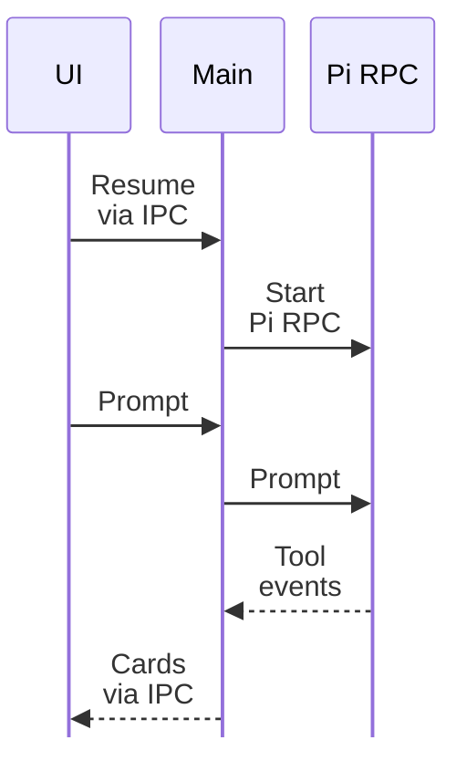

I connected Pidex's desktop workbench to actual Pi workspaces and sessions. The
app could import existing session history and resume through `pi --mode rpc`,
with prompt and steer operations going to a running local process.[^runtime]

Streaming events came back through IPC into the timeline, including cards for
bash, read, edit and write activity. That gave the renderer something real to
present instead of a conversation-shaped mockup.

_The check exercised the session and tool-output round trip, beyond opening a window._

## Test the round trip

The PR's Electron check expanded a workspace, resumed a session, sent a bash
prompt and checked the resulting tool card and output. That was a more useful
milestone than opening a window successfully.

The visual work landed alongside it: Pi-inspired tokens, fonts, panels, badges
and bracket buttons, plus the hidden-inset native tab bar. But the runtime
connection was the important boundary in this pass.

Pidex now depended on finding a local Pi executable, with PATH and Homebrew
locations considered by the launch path. The interface and the process behind
it had to agree before session resume could be treated as a working feature.

[^runtime]: [Pidex's workspace import, session resume and RPC change](https://github.com/echohello-dev/pidex/pull/7).
