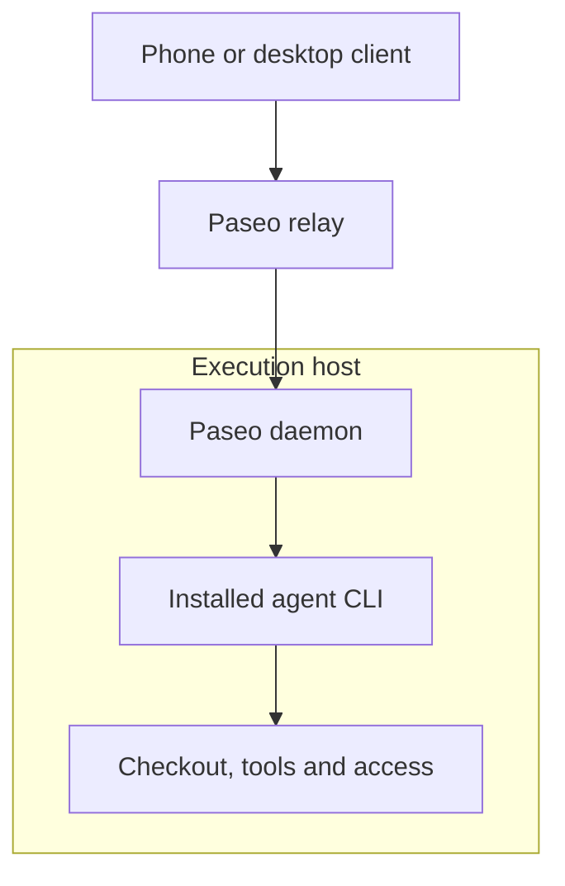

While looking into remote PR housekeeping with [Paseo](https://paseo.sh/), I
asked what would happen to all the tools, MCP connections and authentication
already set up on my laptop. Would a remote agent have those, or would I need
to prepare another machine? This was a research pass; I haven't provisioned a
new worker from it.

Paseo's relay connects a client to a daemon on an existing host. The coding
agent still runs on that host. Its SSH transport also expects the remote
daemon to be running already; it doesn't install or configure it.[^connection]
Paseo launches the installed agent CLI as a subprocess, using that provider's
configuration.[^providers]

The connection reaches the host where the environment already exists. Choosing
another host means checking its checkout, runtimes, tool configuration and
authentication separately. Copying an MCP server definition won't install the
executable it launches or sign the new host into the service.

I then asked how Pi's durable agents fit. One specific limitation made the
boundary clearer: the [`pi-agents` extension](https://pi.dev/packages/pi-agents)
documents that its delegated agents use Pi's built-in coding tools and cannot
use the parent session's MCP servers or other extensions' tools.[^agents]
That is a limitation of this integration, not every application built on Pi
Durable.

My [earlier durability research](/devlog/looking-at-durable-agents) focused on
what survives a restart. This question adds another check: can the recovered
agent actually reach the tools the job requires? A persisted conversation
doesn't establish that.

For PR housekeeping, I'd start with a worker that has the repository, its
build and test tools, model access and GitHub authentication. The open question
is which tasks need my Mac's apps or devices, and which can run with that smaller
environment. I haven't tested that split yet.

[^connection]: [Paseo's client-to-daemon connectivity and SSH prerequisites](https://paseo.sh/docs/connectivity).

[^providers]: [How Paseo launches installed coding-agent providers](https://paseo.sh/docs/providers).

[^agents]: [The pi-agents package's documented MCP and extension-tool limitations](https://pi.dev/packages/pi-agents).
