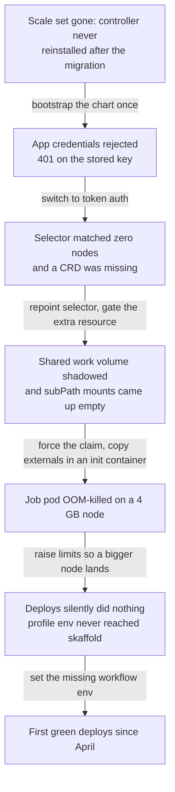

After [writing up the six-month runner outage](/devlog/self-hosted-runners-dead-for-six-months)
I sat down to actually restore the stack. I expected one careful bootstrap of
the runner controller to bring the scale set back. What I got was six separate
failures stacked on top of each other, each one hiding the next.

Nothing was installed at all. The cluster migration that removed the old
runners had also removed the controller install, its custom resources and the
namespace objects, so the org runner list was empty. The chicken-and-egg from
the write-up was exactly as described: both deploy workflows use the
self-hosted label, so the one job that could reinstall the runners had nothing
to run on. Bootstrapping the chart once from my workstation broke the cycle,
and from there the daily deploy could take over.

Then the credentials. The GitHub App I had been using rejects its stored
private key outright; the API answers 401 saying a JSON web token could not be
decoded, and I reproduced that locally with the same key. The chart now
defaults to token auth with a verified personal access token and keeps an
`authMethod: app` switch for when a replacement App exists.[^arc] That PAT is
broader than an App installation and tied to my account, so this is a step
sideways for now, not the finish.

Two failures only appeared once pods existed. The chart's node selector still
asked for a label the workers do not carry since the migration, so controller
and runner pods would have sat Pending forever, and a monitoring resource
assumed a CRD the cluster does not have, so that part is now opt-in. Worse,
once jobs started running, the container hooks were quietly losing work: the
controller template's ephemeral work volume shadowed the runner's shared
persistent claim after the extension merge, so every job pod got a fresh empty
volume instead of the shared one, and subPath volume mounts come up empty on
this container runtime - I reproduced that with a test pod. The externals
directory is now populated by an init container copy instead of a subPath
mount, and the shared claim is forced back after the merge.

The last two were sizing and configuration rot. Runner plus job container plus
Docker-in-Docker on a 4 GB node OOM-killed `mise` installs mid-download (exit
137), so the job container now has a 3 Gi limit and the runner's request is
sized to pull in a bigger node. And the deploy workflows were missing
`GITHUB_USERNAME` for `mise login:github`, while the skaffold profile name used
to leak in through an untracked `.env` file - with that file gone,
`KUBE_CLUSTER_NAME` was never set and the deploys silently did nothing at all.
The toolkit image's helm-secrets plugin is also Helm-4-only and breaks the
Helm 3 it ships with, so the workflow now installs 4.6.5 into an isolated
plugin directory.

The shape of the night was a queue of failures, where each fix simply exposed
the next layer:

Validation was layered for that reason. Template renders, custom resources
installed, controller and listener running, scale set registered, then the
first successful addon deploy since April, then a self-deploy of the runners
workflow with the new scale set re-registered afterwards. Runners report
online, and the follow-up fix to the guardrail's own permissions is merged.

That guardrail is the other thing I wanted from the investigation. An hourly
health check on GitHub-hosted runners - it has to be hosted, since the
self-hosted ones are the thing being watched - opens a tracking issue when no
runner is online, with a recheck first so an ephemeral replacement cycle does
not alert falsely. It fired for real during a replacement gap in testing and
closed itself once the recheck was in.

Still open: the control planes are memory-saturated and one apiserver
OOM-loops, which is where the transient connection resets during this work
came from and why the hooks now retry around them. The PAT should give way to
a recreated App. And I still have not decided whether the runner deploy
should depend on runners at all, because moving it onto hosted runners widens
the trust surface to cluster credentials on a GitHub-hosted machine.

[^arc]: https://github.com/actions/actions-runner-controller
