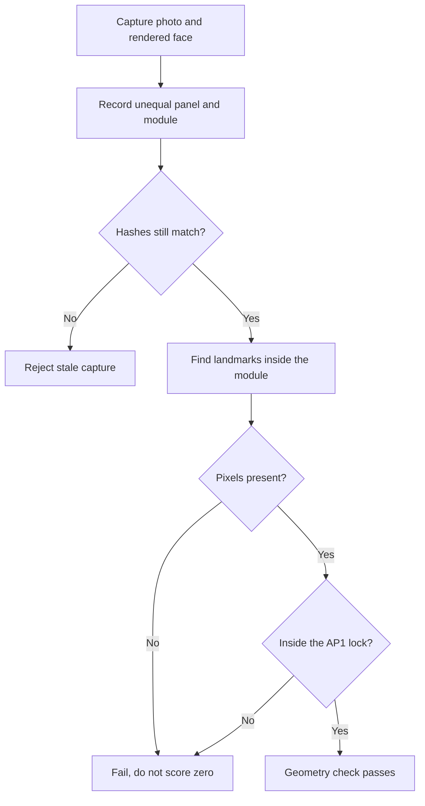

I have been checking the [S2000 digital dash](https://github.com/johnnyhuy/s2000-digital-dash)
against a lit AP1 photograph, not against a feeling that the preview looks close
enough. The comparison image puts that photograph beside the rendered face. The
two panels are not the same width, so the seam is not the middle of the file.

_The lit AP1 photograph used as the geometry reference. The Car Spy, [CC BY 2.0](https://creativecommons.org/licenses/by/2.0/), via [Flickr](https://www.flickr.com/photos/thecarspy/2644733191/)._

Guessing the divider would shift every landmark. A speed readout that is in the
right place on the module could fail, and a displaced one could pass, because
the score was attached to the composite rather than the face. The capture step
now writes the actual panel and module rectangles next to the image, with hashes
of both the composite and the reference photograph.[^geometry]

The measurement then looks only inside that recorded module. It finds the amber
band, the red speed digits and the temperature and fuel bars, and compares those
pixels with the documented AP1 lock. The older plate percentages stay in their
original units. They are not divided by 100, and they are not the acceptance
lock.

A blacked-out capture used to be easy to misread as a measurement of zero. Missing
pixels now fail instead. Moving the speed digits sideways fails that landmark on
its own. Changing the image after the metadata was written is rejected before
any score is produced.

On the live capture, the band apex was 0.40 px from the lock, the speed height
was 0.15 px under it, and the speed's right edge was 0.49 px inside it. Eight
geometry checks passed, and the existing image-hash harness still passed. CI runs
the capture and the check together.[^checks]

The follow-up was smaller, but it stopped the new test from breaking the others.
The capture owns pygame's startup and shutdown. Running that inside the test
process can tear down fonts that another render test still holds. The fixture
now renders in a child process, and the measurement tests still pass when the
display-fit tests run immediately afterwards.[^isolation]

This is a geometry gate, not a claim that the face matches the car. The
photograph is not a calibrated colour or font sample, and a still frame cannot
show timing or motion. The cluster preview is still a bench mock. It is not a
fitted dash, and these checks do not say the graphics are done.

[^geometry]: [Record the real module, then measure inside it](https://github.com/johnnyhuy/s2000-digital-dash/pull/70).

[^checks]: [Python CI run for the geometry gate](https://github.com/johnnyhuy/s2000-digital-dash/actions/runs/39913415943/job/120281384833).

[^isolation]: [Keep the capture's SDL lifecycle out of the test process](https://github.com/johnnyhuy/s2000-digital-dash/pull/71).
