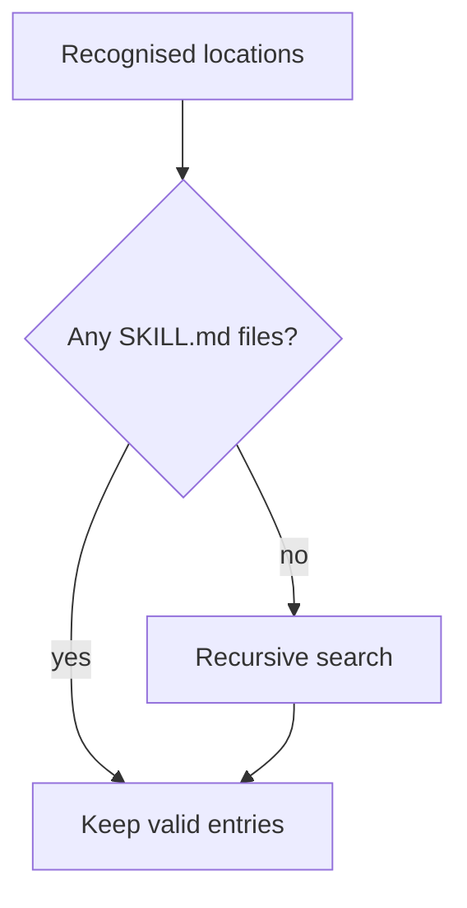

I added [Skillet's skill discovery function](https://github.com/echohello-dev/skillet/pull/28)
to look in recognised project and agent directories before trying a recursive
search. That included the project root, `skills/`, its curated, experimental and
system subdirectories, and the known agent skill directories in the project and
home directory.

The useful boundary is what counts as an empty search. The implementation counts
candidate `SKILL.md` files separately from successfully parsed skills. A malformed
file is skipped, with a warning in verbose mode, but still counts as a candidate.
Finding one does not trigger a wider recursive search.[^discovery]

_A broken skill file and an absent skill file take different paths._

That also means this version can return no skills without using the fallback:
all the candidates in recognised locations might be invalid. It does not rescue
that case by looking elsewhere. Warnings are available when verbose mode is on.

I sorted the roots and candidate directories before collecting results, removed
duplicates by canonical path or skill name, then sorted the final list by name
and path. A symlink to an already discovered skill should not create a second
entry. The committed tests cover that alias, recognised project and agent
locations, invalid-file warnings, and the recursive fallback boundary.[^tests]

This was the discovery slice. The [portable installer](/devlog/skillet-portable-installer)
was a separate change later that morning, with its own link and copy behaviour.

[^discovery]: [Discovery implementation at the merged commit](https://github.com/echohello-dev/skillet/blob/ecc068ad959e8735311617aeb4750db8a0cfb40d/src/skills/discovery.ts).

[^tests]: [Committed discovery tests](https://github.com/echohello-dev/skillet/blob/ecc068ad959e8735311617aeb4750db8a0cfb40d/tests/skills/discovery.test.ts).
