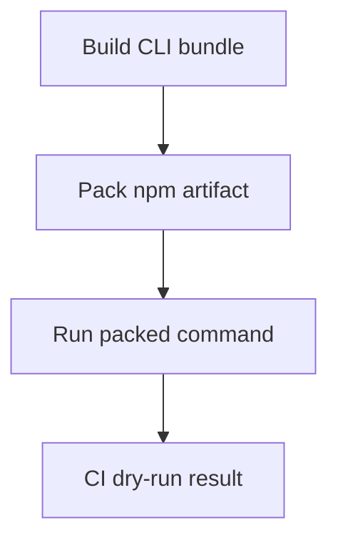

Skillet already built a Node-compatible CLI bundle, but publishing to npm still
depended on a manual step. I added a repeatable publishing path and aligned the
package name, executable and help text around `sklt`.[^publishing]

The workflow can publish from a GitHub release or run manually from an explicit
ref. It also supports dry runs and skips a version that is already published.

## Check what users will install

The useful addition was the reusable npm-publishing dry-run task. CI now exercises
the package path, including packing the artifact and running its command, rather
than stopping at whether the source built.

_The dry run checks the package users receive, rather than only the source build._

That tests a different boundary. The executable can work in the repository while
the package has the wrong files, entrypoint or command name. Aligning the docs
with `npx sklt` only helps if the packed package actually provides that command.

The change merged with a release-triggered workflow and a manual verification
route. I wanted the next publish to be an ordinary, inspectable operation rather
than something that depended on remembering the last set of terminal commands.

[^publishing]: [Skillet's npm package naming and publish workflow](https://github.com/echohello-dev/skillet/pull/52).
