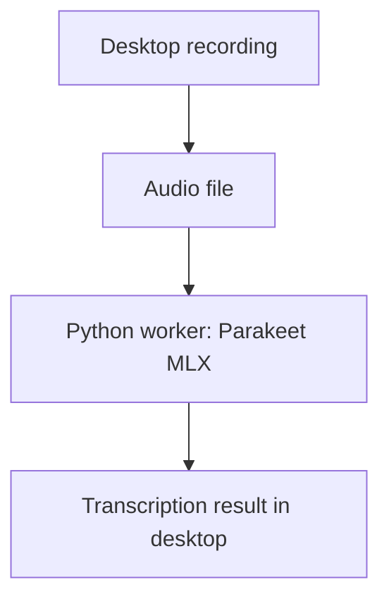

I started the desktop-app work for Transcribe Me with Electron, React and a Python
transcription worker. The initial commit connected the desktop controls to a
Parakeet MLX path rather than leaving the interface as a standalone mockup.[^start]

The app had home, settings, models and history views. The main process owned the
recording lifecycle, tray and global shortcut, while a preload bridge carried
events back to the renderer. Clipboard and auto-paste behaviour were part of
that desktop integration work too.

## Keep the local path explicit

The Python worker loaded a model and transcribed an audio file. Model loading
could download weights on first use, so local inference still needed a model
setup path; it was not the same thing as an app with no installation or download
requirements.

_Local transcription still required model setup, including a possible first-use weights download._

I am keeping this milestone tied to the first commit. The PR later grew more
model-management and cloud-provider features, and did not merge until September.
Those later changes were not all present on this day.

The useful starting point was the end-to-end structure: recording, a worker,
results and desktop interactions, with clear boundaries between them.

[^start]: [The initial Transcribe Me desktop implementation](https://github.com/echohello-dev/transcribe-me/commit/33cbb8d7a9ea639bdb9b6c96843256e0da2c68d8).
