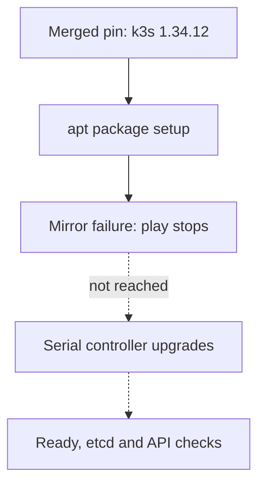

I spent this afternoon patching my three-controller k3s cluster toward a
current Kubernetes release. The first thing I found was that my Ansible role
could not upgrade anything at all. The install task is guarded by a `creates:`
check on the k3s binary, so once a node has k3s installed the task is skipped
forever. Changing the pinned version in the inventory and re-running the
playbook changed nothing, which is exactly what happened the last few times I
bumped that pin.

The fix follows the upgrade path k3s actually documents: re-run the
installation script with `INSTALL_K3S_VERSION` set to the target release, and
it rewrites the systemd unit and restarts the service in place.[^k3s] So the
role now reads `k3s --version` on the node, compares it with the pin, and
refuses to proceed if they differ by more than one minor version. Kubernetes
does not let kube-apiserver skip minors, and kubelets are allowed to lag up to
three, so the safe walk is one minor at a time.[^skew] My cluster sits three
minors behind stable, so the plan is 1.33.1, then 1.34.12, then 1.35.9, then
1.36.5.

The pin that merged today is deliberately 1.34.12 and not the newest stable.
Merging into this repo fires the deploy pipeline immediately, so whatever
version lands is the version the pipeline tries to apply. A pin at 1.36.5
would have automerged into a deploy that my own one-minor guard rejects. One
minor per pull request, applied and confirmed, then the next.

The other half of the work was ordering, because restarting a control-plane
node briefly takes its pods and its API traffic with it. My deploy restarts one
controller at a time and will not touch the next until the previous one reports
Ready on the target release, every etcd member answers healthy, and the API
endpoint is accepting connections again. The node currently holding the API
virtual IP goes last, since restarting that one moves the endpoint and drops
in-flight connections. I would rather the VIP hop happen once, after the other
two are already on the new release.

The change merged this evening. The cluster is still on 1.33.1. The
merge-triggered deploy died before any node restarted, on an earlier apt task
that cannot update against my nodes' end-of-life Ubuntu release: the archives
no longer serve Release files, so the whole play fails at package setup and the
upgrade logic never runs. Nothing in the k3s changes is wrong as far as I can
tell, it just has not been exercised yet.

_The merged upgrade logic was still unexercised. The cluster remained on 1.33.1._

The sharper surprise was that the deploy run still went green. Every deploy
step in that workflow is marked `continue-on-error`, so a failed step fails the
step and not the job, and the run ends looking successful. The failure is only
in the step logs. I nearly took the green tick as "cluster upgraded". A deploy
that reports success while deploying nothing is worse than one that fails
loudly, and I am going to change what a deploy failure does to the run status.

Still open: the nodes need a release upgrade before their package mirrors work
again, then the 1.33.1 to 1.34.12 walk happens for real, watched end to end,
and the later pins follow once the cluster shows the previous release.

[^k3s]: https://docs.k3s.io/upgrades/manual

[^skew]: https://kubernetes.io/releases/version-skew-policy/
