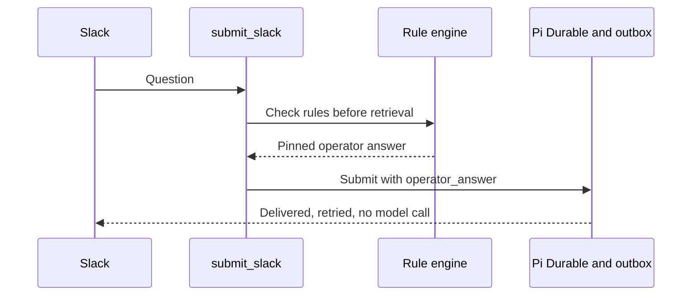

[Wingman](https://github.com/echohello-dev/wingman), my Slackbot for enhancing
channel responses, answers questions with retrieval and generation. That is
the wrong tool for a question that already has an approved answer. The rules
layer now runs first: rules load from config, and the ask path checks them
before retrieval and before generation, so a matched question gets a pinned
operator answer instead of a generated one
([PR #16](https://github.com/echohello-dev/wingman/pull/16),
[closing #15](https://github.com/echohello-dev/wingman/issues/15)).

Placement is the lesson. A rules check that runs only at generation time still
pays for retrieval and can still reach the model; checking before both halves
keeps a known question entirely off the generative path.

The Slack path is the open slice. `RAGEngine.submit_slack` checks the rule
engine before retrieval and submits a matched question to Pi Durable carrying
the pinned answer in `operator_answer`, and the worker delivers it through the
existing job outbox without calling the model, so Slack delivery stays
durable, retried and idempotent like any generated answer
([PR #20](https://github.com/echohello-dev/wingman/pull/20), open at the time
of writing).

_The unmatched path is unchanged: retrieval and generation answer as before._

Inspection landed alongside the rules. Read-only conversation endpoints let
the dashboard inspect past conversations: `GET /api/conversations` returns one
summary per distinct conversation with a total count, and
`GET /api/conversations/{conversation_id}` returns its turns in order, both
with limit and offset pagination
([PR #18](https://github.com/echohello-dev/wingman/pull/18),
[closing #17](https://github.com/echohello-dev/wingman/issues/17)).
Verification was the repository's install and backend test gates
(`mise run install`, `mise run test-backend`).
