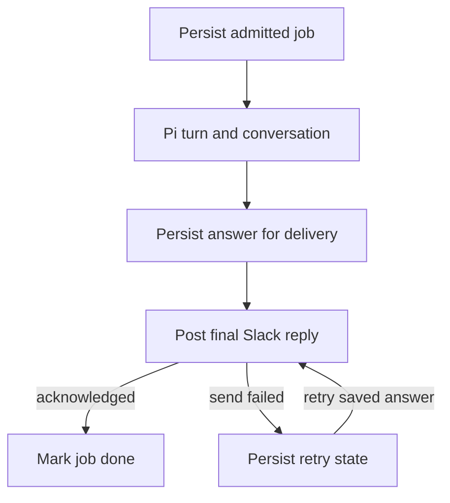

After the logging work, I asked whether [Wingman](https://github.com/echohello-dev/wingman)
could move its agent runtime to Pi and use durable agents. I chose
[Pi Durable](https://github.com/earendil-works/pi/tree/main/packages/durable),
then built a local integration around its SQLite storage. The package is
experimental, and merging the integration does not establish that it is ready
for production.[^durable]

Python still retrieves the relevant Slack threads and documents. The new Node
runtime handles model turns and conversation history, with a persistent job
queue around it. A stable request ID identifies a retry of the same question;
the conversation ID identifies the history it belongs to. Those are different
things. Reusing a request ID with a different question is rejected.

The important boundary turned out to be after generation. A recovered model
answer does not mean Slack received it. I persist the answer before attempting
delivery, so a failed send can retry the saved answer without asking the model
to generate it again. The intended Slack path looks like this:

That still leaves an awkward case: Slack can accept a message and the
acknowledgement can get lost. The sender uses a stable message ID, but I am
still treating delivery as at least once. An exhausted delivery failure needs
inspection before replaying it; blindly resubmitting could duplicate a reply.

The useful local check was killing the runtime process during generation. The
test reopened the same SQLite storage, submitted the same request ID and got a
recovered answer. A separate test failed delivery, reopened the queue and sent
the persisted answer without a second generation. These use a fake model
provider and real SQLite, not live model or Slack calls.

I then exercised the local runtime against MiMo V2.6 Flash. It recovered a
grounded answer after interruption, replayed the saved answer for the same
request ID, and returned that answer through the Python client. Follow-up memory
and conversation isolation passed the later complete runs. The first live
follow-up assertion had failed, though, and I have not established why that
first answer missed the remembered fact. A passing smoke test is a useful check,
not a reliability guarantee.

Six runtime tests and 26 focused backend tests passed locally, along with the
container build. The [runtime migration is merged](https://github.com/echohello-dev/wingman/pull/14),
and its CI checks passed. The live smoke test sent zero Slack messages; I have
not deployed the runtime or verified real Slack delivery. Final replies replace
progress streams, and the old PostgreSQL conversation history is not imported.
Those migration decisions still need validation in actual use.

[^durable]: [Pi Durable's persistence, resumption and request-ID semantics](https://raw.githubusercontent.com/earendil-works/pi/main/packages/durable/README.md).
