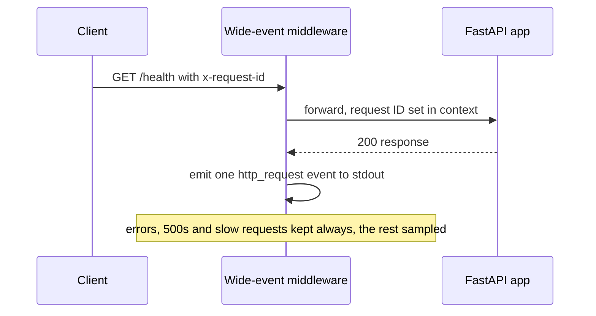

Wingman is my Slack assistant side project - a FastAPI backend, a Slack bot and
a RAG store - and until tonight it logged with `print`. The task I had sitting
open was a structured logging baseline: define the schema, document where the
logs actually go, and write down what a serious assessment would still need.
The approach I went with is one wide event per request instead of scattered
ad-hoc lines.[^pr11]

The event shape is small on purpose. Every HTTP request produces exactly one
`http_request` event carrying the request ID (taken from `x-request-id` when
the caller sends one, generated otherwise, and mirrored into a trace ID),
method, path, status and duration, plus a sample reason. Errors attach their
class, a redacted message and a hash of the stack rather than the stack
itself. Here is the real line from a local smoke request where I sent
`x-request-id: screenshot-1`:

```json
{
  "timestamp": "2026-10-18T12:39:15.884974+00:00",
  "level": "INFO",
  "service_name": "wingman-backend",
  "environment": "local-demo",
  "logger": "wingman.wide_event",
  "message": "http_request",
  "event_type": "http_request",
  "request_id": "screenshot-1",
  "trace_id": "screenshot-1",
  "request_method": "GET",
  "request_path": "/health",
  "route": "/health",
  "status_code": 200,
  "duration_ms": 0.52,
  "error_class": null,
  "error_message": null,
  "sample_reason": "RANDOM"
}
```

The middleware sits under the app as pure ASGI, records the status from the
response, and emits in a `finally` block so the event lands even when the
handler raises:



Redaction is fail-closed by field meaning. Any field whose normalised name
looks like a token, secret, password, authorisation header, cookie, credential
or email is dropped wholesale, and strings are scrubbed for email, Slack
token, API key and card patterns before truncation. The fail-closed part is
what I care about: an unknown field with a sensitive-looking name disappears
rather than getting a chance to leak.

The bug I did not expect was import order. The formatter stamps a service name
into every event, and configuring logging at import time of the Slack bot
module overwrote the API's setup, so the API's own events came out labelled
`wingman-bot`. The fix is boring once seen - configure logging at the top of
each process entrypoint, before the singleton imports - but tracing a wrong
value in one JSON field back to a module import took a minute.[^pr13]

The follow-up change reconciled an earlier abandoned patch against the
controls that had already landed, and added subprocess checks that run the API
and bot and assert on actual stdout rather than the formatter in isolation.
Those checks are what caught the import-order class of problem directly. They
also surfaced a CI quirk: the image tag template used `{{branch}}`, which
expands to nothing on pull request builds and produced invalid tags, so the
workflow now uses a stable `sha-` prefix.

What the documentation deliberately does not claim: logs go to stdout only.
There is no central sink and no rotation configured, and the 7/30/90 day
retention tiers recorded in the doc are targets, not something in force.
Collection needs a real Slack token and RAG tests need Postgres, so parts of
the full suite still do not collect here.

[^pr11]: https://github.com/echohello-dev/wingman/pull/11

[^pr13]: https://github.com/echohello-dev/wingman/pull/13
